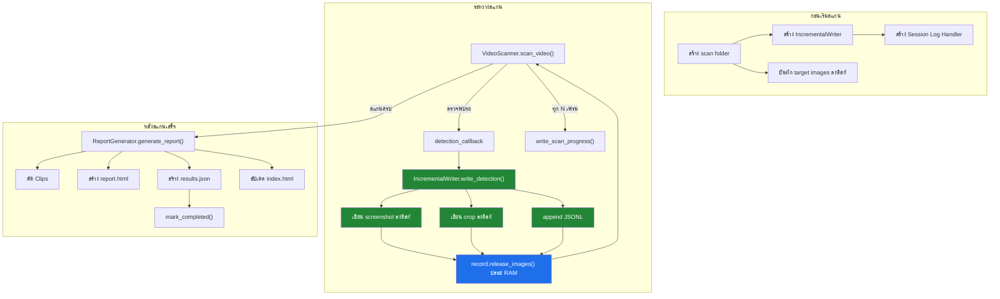
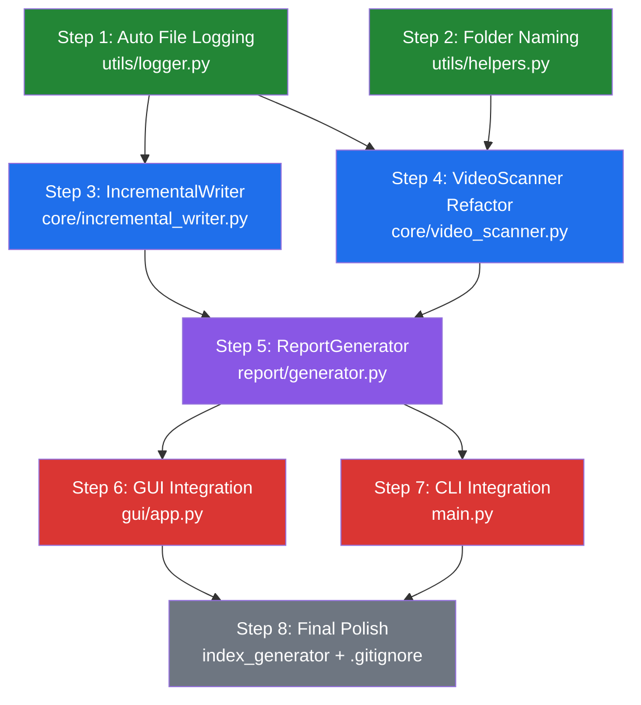

# 🛡️ Eyelnw — Blueprint Phase 2.5: Crash-Resilient Architecture

> **โปรเจกต์:** Eyelnw v1.2.0  
> **เฟส:** Phase 2.5 — Crash Resilience & Operational Hardening  
> **อ้างอิง:** [Blueprint Phase 2](file:///d:/Universal/Eyelnw/Application-Context/Phase2/Blueprint_Implement_Phase2.md) | [Phase 2 Handoff](file:///d:/Universal/Eyelnw/Application-Context/Phase2/HANDOFF_Phase2.md)  
> **วันที่จัดทำ:** 2026-10-01  
> **สถานะ:** 📋 พร้อม Implement

---

## 📋 สารบัญ

1. [ภาพรวม Phase 2.5](#1-ภาพรวม-phase-25)
2. [Root Cause Analysis](#2-root-cause-analysis)
3. [Feature 1: Incremental Auto-Save](#3-feature-1-incremental-auto-save)
4. [Feature 2: RAM Optimization](#4-feature-2-ram-optimization)
5. [Feature 3: Auto File Logging](#5-feature-3-auto-file-logging)
6. [Feature 4: Human-Readable Folder Naming](#6-feature-4-human-readable-folder-naming)
7. [สถาปัตยกรรมที่เปลี่ยนแปลง](#7-สถาปัตยกรรมที่เปลี่ยนแปลง)
8. [ไฟล์ที่ต้องแก้ไข / สร้างใหม่](#8-ไฟล์ที่ต้องแก้ไข--สร้างใหม่)
9. [ลำดับการ Implement](#9-ลำดับการ-implement)
10. [เกณฑ์การทดสอบ](#10-เกณฑ์การทดสอบ)

---

## 1. ภาพรวม Phase 2.5

### 🎯 แรงจูงใจ (Motivation)

จากปัญหาจริง: **เมื่อเปิดรันโปรแกรมทิ้งไว้นานๆ โปรแกรม Crash (OOM, GPU Reset, Windows Sleep) แล้วผลลัพธ์ทั้งหมดหายไป** เนื่องจากระบบเก็บข้อมูลใน RAM ทั้งหมดแล้วเขียนดิสก์เฉพาะตอนจบ

| # | ฟีเจอร์ | ประเภท | ความซับซ้อน |
|---|---------|--------|-------------|
| 1 | Incremental Auto-Save (บันทึกทันที) | 🏗️ Architecture Overhaul | ⭐⭐⭐⭐ สูง |
| 2 | RAM Optimization (ประหยัดหน่วยความจำ) | 🔧 Performance Tuning | ⭐⭐⭐ ปานกลาง-สูง |
| 3 | Auto File Logging (บันทึก Log อัตโนมัติ) | ✨ New Feature | ⭐ ง่าย |
| 4 | Human-Readable Folder Naming (ชื่อโฟลเดอร์อ่านง่าย) | 🔧 UX Improvement | ⭐⭐ ปานกลาง |

### หลักการสำคัญ

- **ไม่ทำลายฟีเจอร์เดิม** — ทุกอย่าง Phase 1-2 ยังทำงานปกติ
- **Backward Compatible** — โครงสร้าง output เดิม (`report.html`, `data/results.json`) ยังคงเดิม
- **Crash-Safe** — ข้อมูลที่ตรวจพบแล้วต้องไม่สูญหาย
- **Observable** — ตรวจสอบย้อนหลังได้เสมอผ่าน Log File

---

## 2. Root Cause Analysis

### 2.1 ปัญหาที่พบ 3 ระดับ

| ระดับ | ปัญหา | ผลกระทบ | อาการ |
|-------|--------|---------|--------|
| **Critical** | ข้อมูลเก็บใน RAM ทั้งหมด ไม่เขียนดิสก์จนกว่าจะจบ | Crash = ข้อมูลหาย 100% | โฟลเดอร์ output ว่างเปล่า |
| **High** | `annotated_frame` (Full HD ~6MB) เก็บใน RAM ทุกเฟรม | RAM เต็ม → Windows OOM Kill | โปรแกรมปิดตัวเงียบ |
| **Medium** | Logger ไม่เขียนลงไฟล์ | ไม่มีร่องรอยให้ตรวจสอบ Crash | ไม่ทราบว่าทำงานถึงขั้นไหน |

### 2.2 RAM ที่สะสมจากโค้ดปัจจุบัน

```
ไฟล์: core/video_scanner.py (บรรทัด 179-190)

DetectionRecord 1 ชุด:
├── annotated_frame: np.ndarray  ≈ 1920×1080×3 = ~6.2 MB
├── car_crop: np.ndarray         ≈ 200×300×3   = ~180 KB
├── match_result + metadata      ≈ ~1.2 KB
└── รวม ~6.4 MB ต่อ 1 detection

สแกนวิดีโอ 4 ชม. ตรวจพบ 200 ครั้ง:
→ 200 × 6.4 MB ≈ 1.28 GB (เฉพาะ detection)
→ + YOLO + ResNet50 + OpenCV ≈ 1-2 GB
→ รวม 2.5-3.5 GB → ใกล้จุดวิกฤตเครื่อง 8 GB RAM
```

---

## 3. Feature 1: Incremental Auto-Save

### 3.1 เป้าหมาย

**บันทึก Screenshot และข้อมูลเหตุการณ์ลงดิสก์ทันทีที่ตรวจพบ** — แม้ Crash กลางคัน ข้อมูลที่รันผ่านมายังอยู่บนดิสก์

### 3.2 โมดูลใหม่: `IncrementalWriter`

**ไฟล์ใหม่:** `core/incremental_writer.py`

**แนวคิด:** Write-Through Architecture — ใช้ JSONL (JSON Lines) format สำหรับ append ทีละบรรทัด ไม่ต้อง parse ทั้งไฟล์ แม้ write ค้างกลางทาง บรรทัดก่อนหน้ายังอ่านได้

```python
class IncrementalWriter:
    """
    Write-Through: บันทึกผลการตรวจจับลงดิสก์ทันที ไม่ต้องรอจนสแกนเสร็จ
    ใช้ JSONL format — append ได้ทีละบรรทัด, crash-safe
    """

    def __init__(self, scan_folder: Path):
        self.scan_folder = scan_folder
        self.screenshots_dir = scan_folder / "screenshots"
        self.crops_dir = scan_folder / "crops"
        self.data_dir = scan_folder / "data"
        self._detection_count = 0

        # สร้างโครงสร้างโฟลเดอร์ล่วงหน้า
        for d in [self.screenshots_dir, self.crops_dir, self.data_dir]:
            d.mkdir(parents=True, exist_ok=True)

        self._jsonl_path = self.data_dir / "detections.jsonl"
        self._progress_path = self.data_dir / "scan_progress.json"

    def write_detection(
        self,
        annotated_frame: np.ndarray,
        car_crop: np.ndarray,
        video_path: Path,
        frame_index: int,
        timestamp: float,
        timestamp_str: str,
        bbox: list[int],
        class_name: str,
        combined_score: float,
        color_score: float,
        feature_score: float,
        deep_score: float,
        ocr_score: float,
        detected_plate: str | None,
        detected_color: str,
    ) -> dict:
        """บันทึก 1 detection ลงดิสก์ทันที. Returns dict ที่มี paths"""
        self._detection_count += 1
        det_id = self._detection_count
        time_tag = timestamp_str.replace(":", "")

        # 1. เขียน screenshot ทันที
        shot_name = f"match_{det_id:03d}_{time_tag}.jpg"
        shot_path = self.screenshots_dir / shot_name
        self._save_image(annotated_frame, shot_path)

        # 2. เขียน car crop
        crop_name = f"crop_{det_id:03d}_{time_tag}.jpg"
        crop_path = self.crops_dir / crop_name
        self._save_image(car_crop, crop_path)

        # 3. Append metadata เป็น JSONL
        record = {
            "detection_id": det_id,
            "video_path": str(video_path),
            "video_name": video_path.name,
            "frame_index": frame_index,
            "timestamp": timestamp,
            "timestamp_str": timestamp_str,
            "bbox": bbox,
            "class_name": class_name,
            "scores": {
                "combined": round(combined_score, 4),
                "color": round(color_score, 4),
                "feature": round(feature_score, 4),
                "deep": round(deep_score, 4),
                "ocr": round(ocr_score, 4),
            },
            "detected_plate": detected_plate,
            "detected_color": detected_color,
            "screenshot_rel": f"screenshots/{shot_name}",
            "crop_rel": f"crops/{crop_name}",
            "saved_at": datetime.now().isoformat(),
        }
        with open(self._jsonl_path, "a", encoding="utf-8") as f:
            f.write(json.dumps(record, ensure_ascii=False) + "\n")

        return {
            "detection_id": det_id,
            "screenshot_path": shot_path,
            "crop_path": crop_path,
        }

    def write_scan_progress(self, current_video, video_index,
                            total_videos, current_frame, total_frames,
                            detections_so_far):
        """เขียน progress ล่าสุดลงดิสก์ (overwrite) — ดูได้ว่า crash ที่ไหน"""
        progress = {
            "current_video": current_video,
            "video_index": video_index,
            "total_videos": total_videos,
            "current_frame": current_frame,
            "total_frames": total_frames,
            "detections_so_far": detections_so_far,
            "last_updated": datetime.now().isoformat(),
            "status": "scanning",
        }
        with open(self._progress_path, "w", encoding="utf-8") as f:
            json.dump(progress, f, ensure_ascii=False, indent=2)

    def mark_completed(self):
        """เขียน status = completed เมื่อจบปกติ"""
        # อ่าน progress → เพิ่ม status + completed_at → เขียนกลับ

    @staticmethod
    def load_detections_jsonl(jsonl_path: Path) -> list[dict]:
        """อ่าน JSONL กลับมาเป็น list — ข้ามบรรทัดที่เสียหายอัตโนมัติ"""
```

### 3.3 แก้ไข `VideoScanner.scan_video()` — เพิ่ม detection_callback

**ไฟล์:** [`core/video_scanner.py`](file:///d:/Universal/Eyelnw/core/video_scanner.py)

```python
def scan_video(
    self,
    video_path: str | Path,
    progress_callback=None,
    detection_callback=None,  # ← 🆕 เรียกทุกครั้งที่ตรวจพบรถ
) -> list[MatchGroup]:
```

ภายใน scan loop หลังบรรทัดที่ 190:

```python
if match_res.is_match:
    annotated = draw_detection_box(...)
    record = DetectionRecord(...)
    detections.append(record)

    # ▶ 🆕 แจ้ง callback ให้บันทึกลงดิสก์ทันที
    if detection_callback:
        try:
            detection_callback(record)
        except Exception as e:
            logger.error(f"Detection callback error: {e}")
```

> **Thread Safety:** `IncrementalWriter` ใช้ JSONL append ที่ atomic ต่อบรรทัด จึง thread-safe สำหรับ single-writer

### 3.4 แก้ไข `gui/app.py` — เชื่อม IncrementalWriter

**ไฟล์:** [`gui/app.py`](file:///d:/Universal/Eyelnw/gui/app.py) — ใน `_run_scan_thread()`:

```python
# ▶ สร้าง scan folder + IncrementalWriter ก่อนเริ่มสแกน
from core.incremental_writer import IncrementalWriter
scan_folder = self._create_scan_folder()
writer = IncrementalWriter(scan_folder)

# ▶ บันทึก target images ลงดิสก์ทันที
self._save_target_images_immediately(target_profile, scan_folder)

for i, vid_path in enumerate(video_paths):
    def on_detection(record):
        writer.write_detection(
            annotated_frame=record.annotated_frame,
            car_crop=record.car_crop,
            # ... ส่งข้อมูลทั้งหมดจาก record ...
        )

    events = self.active_scanner.scan_video(
        vid_path,
        progress_callback=progress_cb,
        detection_callback=on_detection,  # ← 🆕
    )

writer.mark_completed()

# ReportGenerator ใช้ scan_folder ที่มี screenshots แล้ว
report_path, folder_path = generator.generate_report(
    ...,
    existing_scan_folder=scan_folder,  # ← 🆕
)
```

### 3.5 แก้ไข `ReportGenerator` — รองรับ Pre-existing Folder

**ไฟล์:** [`report/generator.py`](file:///d:/Universal/Eyelnw/report/generator.py)

```python
def generate_report(
    self, ...,
    existing_scan_folder: Path | None = None,  # ← 🆕
) -> tuple[Path, Path]:
    """ถ้า existing_scan_folder มี → ไม่สร้างโฟลเดอร์ใหม่ + ข้าม screenshots ที่มี"""
    if existing_scan_folder and existing_scan_folder.exists():
        scan_folder = existing_scan_folder
    else:
        # logic เดิม: สร้างโฟลเดอร์ใหม่

    # ▶ ข้าม screenshot ที่มีอยู่แล้ว
    for event in events:
        if not shot_path.exists():
            self.clip_cutter.save_screenshot(...)
```

### 3.6 โครงสร้างโฟลเดอร์ใหม่

```
output/
└── scan_2026-10-01_14-35-00/
    ├── screenshots/           ← ✅ เขียนทันทีที่ตรวจพบ (เดิมเขียนตอนจบ)
    ├── crops/                 ← 🆕 ภาพรถ crop ขนาดเล็ก
    ├── clips/                 ← เดิม: ตัดหลังสแกนจบ
    ├── target/                ← เดิม: reference images
    ├── data/
    │   ├── detections.jsonl   ← 🆕 JSONL: append ทีละบรรทัดตอน scan
    │   ├── scan_progress.json ← 🆕 ความคืบหน้าล่าสุด
    │   └── results.json       ← เดิม: สร้างตอนจบ (final summary)
    ├── logs/
    │   └── scan.log           ← 🆕 Log เฉพาะรอบนี้ (Feature 3)
    └── report.html            ← เดิม: สร้างตอนจบ
```

### 3.7 Recovery Mode — ดูผลลัพธ์เมื่อ Crash

เมื่อ Crash กลางคัน ผู้ใช้ยังสามารถ:
1. **ดูรูปภาพ:** `screenshots/` มีรูปทุกจุดที่ตรวจพบ
2. **ดูข้อมูลละเอียด:** `data/detections.jsonl` มีเวลา คะแนน สี ป้ายทะเบียน
3. **ดู progress:** `data/scan_progress.json` ทราบว่าถึงวิดีโอไหน เฟรมที่เท่าไหร่
4. **ดู crop รถ:** `crops/` มีภาพตัดรถทุกจุด

> **อนาคต (Phase 3):** ปุ่ม "Resume Last Scan" อ่าน JSONL + progress แล้วสร้าง report.html ได้ทันที

---

## 4. Feature 2: RAM Optimization

### 4.1 เป้าหมาย

**ไม่เก็บ Full HD Frame ใน RAM ตลอด** — IncrementalWriter บันทึกลงดิสก์แล้ว จึงปล่อย image data ออกจาก RAM ได้ทันที

### 4.2 แก้ไข `DetectionRecord`

**ไฟล์:** [`core/video_scanner.py`](file:///d:/Universal/Eyelnw/core/video_scanner.py)

```python
@dataclass
class DetectionRecord:
    video_path: Path
    frame_index: int
    timestamp: float
    timestamp_str: str
    bbox: list[int]
    match_result: MatchResult
    class_name: str

    # ▶ เปลี่ยน: อนุญาตให้เป็น None ได้ (หลัง release)
    annotated_frame: np.ndarray | None = None
    car_crop: np.ndarray | None = None
    screenshot_path: Path | None = None    # 🆕 path ไปหาไฟล์บนดิสก์
    crop_path: Path | None = None          # 🆕 path ไปหาไฟล์บนดิสก์

    def release_images(self):
        """ปล่อย image data ออกจาก RAM หลังเขียนดิสก์แล้ว"""
        self.annotated_frame = None
        self.car_crop = None
```

### 4.3 Write-and-Release ใน Scan Loop

```python
if match_res.is_match:
    record = DetectionRecord(annotated_frame=annotated, car_crop=crop, ...)
    detections.append(record)

    if detection_callback:
        saved = detection_callback(record)
        if saved:
            record.screenshot_path = saved.get("screenshot_path")
            record.crop_path = saved.get("crop_path")
            record.release_images()  # ▶ ปล่อย RAM ทันที
```

### 4.4 ผลลัพธ์ด้าน RAM

| สถานการณ์ | เดิม (Phase 2) | ใหม่ (Phase 2.5) |
|-----------|----------------|-------------------|
| 50 detections | ~320 MB | ~5 MB |
| 200 detections | ~1,280 MB | ~20 MB |
| 500 detections | ~3,200 MB → **OOM Crash** | ~50 MB ✅ |

### 4.5 ผลกระทบต่อ ReportGenerator

```python
# ใน generate_report():
for event in events:
    if event.screenshot_path and event.screenshot_path.exists():
        shot_path = event.screenshot_path  # ใช้ไฟล์ที่มี
    elif event.best_detection.annotated_frame is not None:
        # Fallback: เขียนจาก RAM
        self.clip_cutter.save_screenshot(...)
```

---

## 5. Feature 3: Auto File Logging

### 5.1 เป้าหมาย

**บันทึก log ลงไฟล์ `.log` อัตโนมัติ** — เมื่อ Crash เปิด log file ดูได้ว่าสแกนถึงจุดไหน

### 5.2 กลยุทธ์ Log 2 ระดับ

| Log File | ตำแหน่ง | เนื้อหา |
|----------|---------|---------|
| **Global Log** | `output/logs/eyelnw.log` | ทุกอย่าง (app startup, errors) |
| **Session Log** | `scan_*/logs/scan.log` | เฉพาะรอบสแกนนั้น |

### 5.3 แก้ไข `utils/logger.py`

**ไฟล์:** [`utils/logger.py`](file:///d:/Universal/Eyelnw/utils/logger.py)

```python
from logging.handlers import RotatingFileHandler

LOG_DIR = Path(__file__).resolve().parent.parent / "output" / "logs"

def setup_logger(name="eyelnw", log_file=None, level=logging.INFO,
                 auto_file_log=True):
    logger = logging.getLogger(name)
    logger.setLevel(level)

    if not logger.handlers:
        formatter = logging.Formatter(
            fmt="%(asctime)s [%(levelname)s] [%(name)s] %(message)s",
            datefmt="%Y-%m-%d %H:%M:%S"
        )
        # Console handler (เดิม)
        console_handler = logging.StreamHandler(sys.stdout)
        console_handler.setFormatter(formatter)
        logger.addHandler(console_handler)

        # 🆕 Auto Global Log (RotatingFileHandler 10MB x 3 files)
        if auto_file_log and name == "eyelnw":
            LOG_DIR.mkdir(parents=True, exist_ok=True)
            file_handler = RotatingFileHandler(
                str(LOG_DIR / "eyelnw.log"),
                encoding="utf-8",
                maxBytes=10 * 1024 * 1024,  # 10 MB
                backupCount=3,
            )
            file_handler.setFormatter(formatter)
            logger.addHandler(file_handler)

    return logger


def add_session_log(scan_folder: Path) -> logging.Handler | None:
    """🆕 เพิ่ม session log handler — เรียกตอนเริ่มสแกน"""
    log_path = scan_folder / "logs" / "scan.log"
    log_path.parent.mkdir(parents=True, exist_ok=True)
    formatter = logging.Formatter(
        fmt="%(asctime)s [%(levelname)s] [%(name)s] %(message)s",
        datefmt="%Y-%m-%d %H:%M:%S"
    )
    handler = logging.FileHandler(str(log_path), encoding="utf-8")
    handler.setFormatter(formatter)
    logging.getLogger("eyelnw").addHandler(handler)
    return handler


def remove_session_log(handler: logging.Handler | None):
    """🆕 ลบ session log handler — เรียกตอนสแกนเสร็จ"""
    if handler:
        logging.getLogger("eyelnw").removeHandler(handler)
        handler.close()
```

### 5.4 การใช้งานใน Pipeline

```python
# ใน gui/app.py:
from utils.logger import add_session_log, remove_session_log

session_handler = add_session_log(scan_folder)
try:
    logger.info("Scan session started...")
    # ... scan pipeline ...
finally:
    logger.info("Scan session ended.")
    remove_session_log(session_handler)
```

### 5.5 อัปเดต `.gitignore`

เพิ่ม:
```gitignore
# 8. Log Files
output/logs/
*.log
```

---

## 6. Feature 4: Human-Readable Folder Naming

### 6.1 เป้าหมาย

**ใช้เวลา Local Timezone ในฟอร์แมตที่อ่านง่าย**

| รายการ | เดิม | ใหม่ |
|--------|------|------|
| Format | `scan_20261001_002533` | `scan_2026-10-01_00-25-33` |
| Timezone | local (เหมือนเดิม) | local (เหมือนเดิม) |

### 6.2 เหตุผลที่เลือก `YYYY-MM-DD_HH-MM-SS`

- ✅ อ่านง่าย: `2026-10-01_14-35-00` = 1 ตุลาคม 2026 บ่ายสองครึ่ง
- ✅ Sortable: เรียง alphabetical = เรียงเวลา
- ✅ Windows-safe: ใช้ `-` แทน `:` (ที่ห้ามใช้ใน Windows)
- ✅ Backward Compatible: prefix `scan_` เหมือนเดิม

### 6.3 ฟังก์ชันใหม่ใน `utils/helpers.py`

**ไฟล์:** [`utils/helpers.py`](file:///d:/Universal/Eyelnw/utils/helpers.py)

```python
def generate_scan_folder_name() -> str:
    """
    สร้างชื่อโฟลเดอร์ใน local timezone
    Format: scan_YYYY-MM-DD_HH-MM-SS
    ตัวอย่าง: scan_2026-10-01_14-35-00 (เวลาไทย)
    """
    from datetime import datetime
    return datetime.now().strftime("scan_%Y-%m-%d_%H-%M-%S")


def parse_scan_folder_timestamp(folder_name: str) -> str:
    """
    แปลงชื่อโฟลเดอร์เป็น timestamp อ่านง่าย (รองรับทั้ง format เก่า+ใหม่)

    'scan_20261001_143500'       -> '2026-10-01 14:35:00'
    'scan_2026-10-01_14-35-00'   -> '2026-10-01 14:35:00'
    """
    import re
    name = folder_name.replace("scan_", "")

    # Format ใหม่
    m = re.match(r"(\d{4})-(\d{2})-(\d{2})_(\d{2})-(\d{2})-(\d{2})", name)
    if m:
        y, mo, d, h, mi, s = m.groups()
        return f"{y}-{mo}-{d} {h}:{mi}:{s}"

    # Format เก่า
    m = re.match(r"(\d{4})(\d{2})(\d{2})_(\d{2})(\d{2})(\d{2})", name)
    if m:
        y, mo, d, h, mi, s = m.groups()
        return f"{y}-{mo}-{d} {h}:{mi}:{s}"

    return name
```

### 6.4 จุดที่ต้องแก้ไข

| ไฟล์ | เดิม | ใหม่ |
|------|------|------|
| `report/generator.py` (L50) | `datetime.now().strftime("%Y%m%d_%H%M%S")` | `generate_scan_folder_name()` |
| `report/index_generator.py` (L45) | `scan_dir.name.replace("scan_", "")` | `parse_scan_folder_timestamp(scan_dir.name)` |

โฟลเดอร์เก่าไม่ต้อง rename — ยังเปิดดูได้ปกติ

---

## 7. สถาปัตยกรรมที่เปลี่ยนแปลง

### 7.1 Data Flow ใหม่ (Phase 2.5)



### 7.2 RAM Usage Comparison

| Detections | Phase 2 (เดิม) | Phase 2.5 (ใหม่) |
|------------|----------------|-------------------|
| 50 | ~520 MB | ~205 MB |
| 200 | ~1.5 GB | ~220 MB |
| 500 | ~3.4 GB ❌ OOM | ~250 MB ✅ |

---

## 8. ไฟล์ที่ต้องแก้ไข / สร้างใหม่

### 8.1 ไฟล์ใหม่

| ไฟล์ | Feature | คำอธิบาย |
|------|---------|---------|
| `core/incremental_writer.py` | #1 | Write-Through module สำหรับบันทึกผลลัพธ์ทันที |

### 8.2 ไฟล์ที่ต้องแก้ไข

| ไฟล์ | Feature | การแก้ไข |
|------|---------|---------|
| [`utils/logger.py`](file:///d:/Universal/Eyelnw/utils/logger.py) | #3 | Auto File Log + RotatingFileHandler + Session Log |
| [`utils/helpers.py`](file:///d:/Universal/Eyelnw/utils/helpers.py) | #4 | `generate_scan_folder_name()` + `parse_scan_folder_timestamp()` |
| [`core/video_scanner.py`](file:///d:/Universal/Eyelnw/core/video_scanner.py) | #1, #2 | `detection_callback` + `release_images()` |
| [`report/generator.py`](file:///d:/Universal/Eyelnw/report/generator.py) | #1, #4 | `existing_scan_folder` + folder naming ใหม่ |
| [`report/index_generator.py`](file:///d:/Universal/Eyelnw/report/index_generator.py) | #4 | ใช้ `parse_scan_folder_timestamp()` |
| [`gui/app.py`](file:///d:/Universal/Eyelnw/gui/app.py) | #1, #2, #3 | Wire IncrementalWriter + Session Log |
| [`main.py`](file:///d:/Universal/Eyelnw/main.py) | #1, #3 | CLI mode ใช้ IncrementalWriter + Auto Log |
| [`.gitignore`](file:///d:/Universal/Eyelnw/.gitignore) | #3 | เพิ่ม `*.log` และ `output/logs/` |

### 8.3 ไฟล์ที่ไม่กระทบ

`core/detector.py`, `core/matcher.py`, `core/color_analyzer.py`, `core/feature_extractor.py`, `core/ocr_reader.py`, `core/target_loader.py`, `core/motion_tracker.py`, `report/clip_cutter.py`, `report/templates/*.html`, `gui/scan_panel.py`, `gui/result_panel.py`, `gui/target_panel.py`, `gui/video_panel.py`, `gui/widgets.py`, `utils/settings.py`

---

## 9. ลำดับการ Implement

### 9.1 Dependency Graph



### 9.2 สรุปลำดับ

| Step | ทำอะไร | Feature | เหตุผล |
|------|--------|---------|--------|
| 1 | แก้ `utils/logger.py` | #3 | Foundation — ทุก Step ต้องใช้ |
| 2 | เพิ่มใน `utils/helpers.py` | #4 | Utility functions ที่ใช้ร่วม |
| 3 | สร้าง `core/incremental_writer.py` | #1 | Core module ใหม่ |
| 4 | แก้ `core/video_scanner.py` | #1, #2 | เพิ่ม callback + RAM release |
| 5 | แก้ `report/generator.py` | #1, #4 | รองรับ pre-existing folder |
| 6 | แก้ `gui/app.py` | #1, #2, #3 | Wire ทุกอย่างเข้า GUI |
| 7 | แก้ `main.py` | #1, #3 | Wire ทุกอย่างเข้า CLI |
| 8 | แก้ `index_generator.py` + `.gitignore` | #3, #4 | Final polish |

---

## 10. เกณฑ์การทดสอบ

### 10.1 Feature 1: Incremental Auto-Save

| Test Case | ผลที่คาดหวัง |
|-----------|-------------|
| สแกน 1 ไฟล์ พบ 3 events | ระหว่างสแกน: `screenshots/` มี 3 ไฟล์, `detections.jsonl` มี 3 บรรทัด |
| จำลอง Crash (ปิดโปรแกรมกลางคัน) | โฟลเดอร์มี screenshots + JSONL ที่สแกนผ่านแล้ว |
| `scan_progress.json` ระหว่างสแกน | status = "scanning", มี current_video + current_frame |
| `scan_progress.json` หลังจบ | status = "completed", มี completed_at |
| สแกนจบปกติ | `report.html` สร้างสำเร็จ, screenshots ไม่ถูกเขียนซ้ำ |
| CLI mode | IncrementalWriter ทำงานเหมือน GUI |
| JSONL เสียหายบรรทัดสุดท้าย | `load_detections_jsonl()` ข้ามบรรทัดเสีย อ่านที่เหลือได้ |
| สแกน 2 วิดีโอต่อกัน | detection_id ต่อเนื่อง ไม่ซ้ำ |

### 10.2 Feature 2: RAM Optimization

| Test Case | ผลที่คาดหวัง |
|-----------|-------------|
| สแกนพบ 100+ detections | RAM ไม่เพิ่มตามจำนวน detections |
| `record.annotated_frame` หลัง release | เป็น `None` |
| `record.screenshot_path` หลัง release | ชี้ไปยังไฟล์บนดิสก์ |
| ReportGenerator ใช้ record ที่ release แล้ว | ใช้ `screenshot_path` แทน, ไม่ crash |
| MotionTracker ยังทำงานได้ | ใช้ bbox ไม่ใช่ image ไม่กระทบ |
| `record.car_crop` หลัง release | เป็น `None` |

### 10.3 Feature 3: Auto File Logging

| Test Case | ผลที่คาดหวัง |
|-----------|-------------|
| เปิดโปรแกรม | สร้าง `output/logs/eyelnw.log` อัตโนมัติ |
| เริ่มสแกน | สร้าง `scan_*/logs/scan.log` |
| สแกนเจอรถ | "Match detected..." อยู่ทั้ง `eyelnw.log` และ `scan.log` |
| สแกนจบ | `scan.log` มี "Scan session ended" |
| CLI mode | `eyelnw.log` มี log ของ CLI |
| `eyelnw.log` เกิน 10 MB | สร้าง `.log.1` อัตโนมัติ |
| Crash | log ก่อนหน้ายังอยู่ครบ |

### 10.4 Feature 4: Human-Readable Folder Naming

| Test Case | ผลที่คาดหวัง |
|-----------|-------------|
| สแกนเวลาบ่ายสามโมง (ไทย) | โฟลเดอร์ชื่อ `scan_2026-10-01_15-00-XX` |
| index.html แสดง folder ใหม่ | แสดง `2026-10-01 15:00:XX` |
| index.html แสดง folder เก่า | แปลง `scan_20260930_202935` เป็น `2026-09-30 20:29:35` |
| เรียง alphabetical | เรียงถูกต้องตามเวลา |
| `glob("scan_*")` | จับได้ทั้ง format เก่าและใหม่ |
| สร้าง 2 รอบรวดเร็ว (ภายใน 1 วินาที) | วินาทีต่างกัน ไม่ชน |

---

> **หมายเหตุ:** เอกสารนี้เป็น Blueprint สำหรับวางแผนเท่านั้น ยังไม่ได้ implement ส่วนใดทั้งสิ้น  
> เมื่อพร้อม ให้เริ่ม implement ตาม [ลำดับการ Implement](#9-ลำดับการ-implement) ทีละ Step
