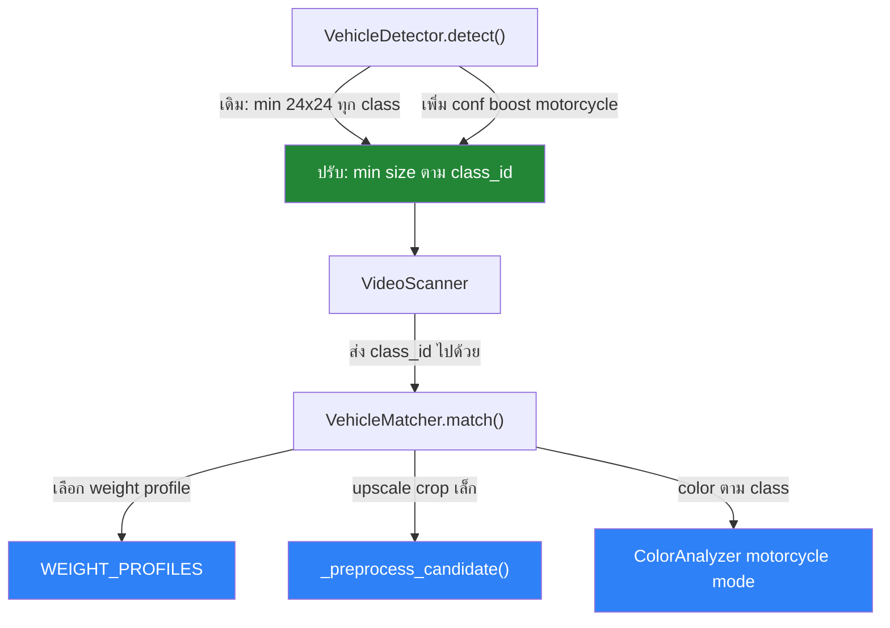
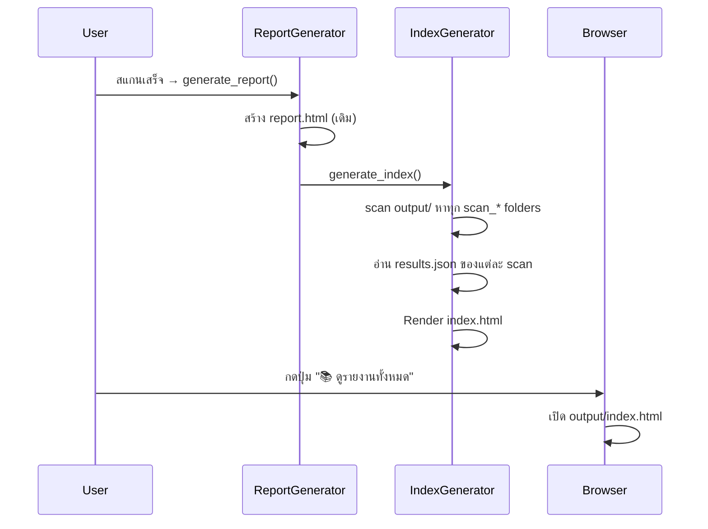
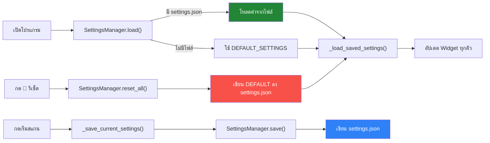
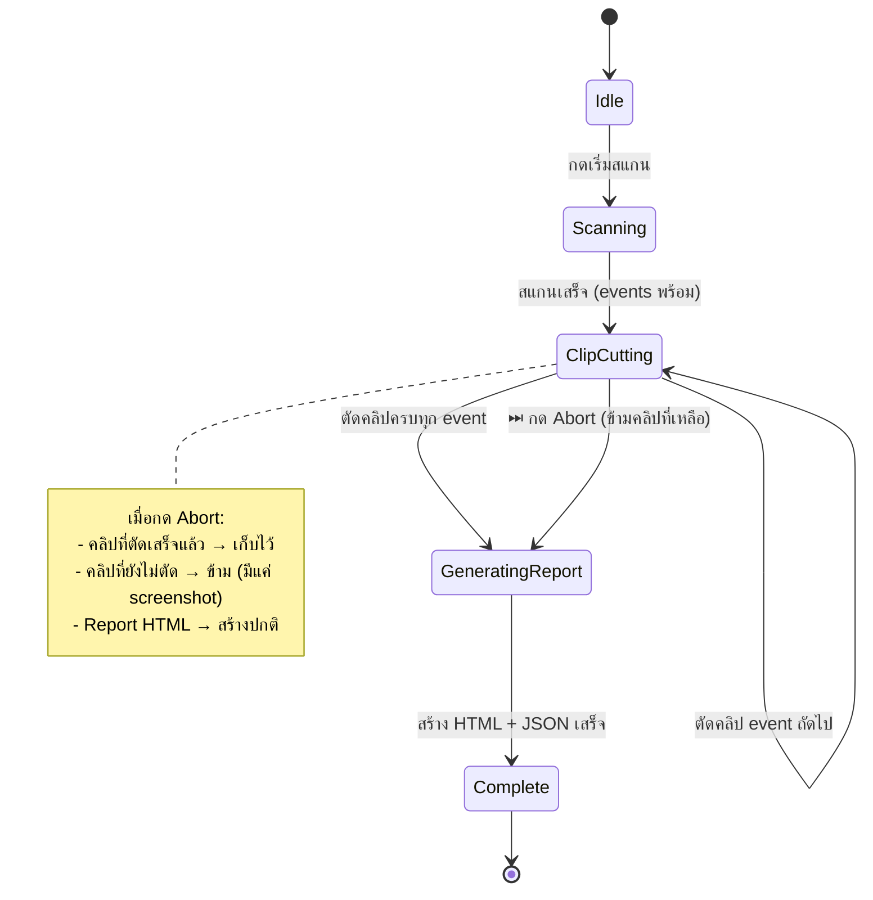
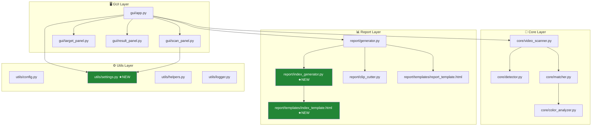

# 🔍 Eyelnw — Blueprint Phase 2: ปรับปรุงและขยายฟีเจอร์

> **โปรเจกต์:** Eyelnw v1.1.0  
> **เฟส:** Phase 2 — Fine-Tuning & Feature Expansion  
> **อ้างอิง:** [Blueprint Phase 1](file:///d:/Universal/Eyelnw/Application-Context/Phase1/Blueprint.md)  
> **วันที่จัดทำ:** 2026-10-01  
> **สถานะ:** 📋 พร้อม Implement

---

## 📋 สารบัญ

1. [ภาพรวม Phase 2](#1-ภาพรวม-phase-2)
2. [Feature 1: ปรับปรุงการตรวจจับมอเตอร์ไซค์](#2-feature-1-ปรับปรุงการตรวจจับมอเตอร์ไซค์)
3. [Feature 2: ระบบบันทึก Report HTML + หน้า Index รวม](#3-feature-2-ระบบบันทึก-report-html--หน้า-index-รวม)
4. [Feature 3: บันทึกค่าตั้งค่า (Persistent Settings)](#4-feature-3-บันทึกค่าตั้งค่า-persistent-settings)
5. [Feature 4: ปุ่มหยุดตัดคลิปกลางคัน (Abort Clip Cutting)](#5-feature-4-ปุ่มหยุดตัดคลิปกลางคัน-abort-clip-cutting)
6. [แผนผังสถาปัตยกรรมที่เปลี่ยนแปลง](#6-แผนผังสถาปัตยกรรมที่เปลี่ยนแปลง)
7. [ไฟล์ที่ต้องแก้ไข / สร้างใหม่](#7-ไฟล์ที่ต้องแก้ไข--สร้างใหม่)
8. [ลำดับการ Implement](#8-ลำดับการ-implement)
9. [เกณฑ์การทดสอบ](#9-เกณฑ์การทดสอบ)

---

## 1. ภาพรวม Phase 2

### เป้าหมายหลัก

Phase 2 มุ่งเน้น 4 ฟีเจอร์หลัก ที่เป็นการปรับจูน (Fine-Tuning) และขยายความสามารถ (Feature Expansion) บนพื้นฐาน Phase 1 ที่ทำงานได้แล้ว:

| # | ฟีเจอร์ | ประเภท | ความซับซ้อน |
|---|---------|--------|-------------|
| 1 | ปรับปรุงการตรวจจับมอเตอร์ไซค์ | 🔧 Fine-Tuning | ⭐⭐⭐ ปานกลาง-สูง |
| 2 | บันทึก Report HTML + หน้า Index รวม | ✨ New Feature | ⭐⭐ ปานกลาง |
| 3 | บันทึกค่าตั้งค่า (Persistent Settings) | ✨ New Feature | ⭐⭐ ปานกลาง |
| 4 | ปุ่มหยุดตัดคลิปกลางคัน | ✨ New Feature | ⭐⭐⭐ ปานกลาง-สูง |

### หลักการสำคัญ

- **ไม่ทำลายฟีเจอร์เดิม** — ทุกอย่างที่ทำงานใน Phase 1 ต้องยังคงทำงานได้ปกติ
- **Backward Compatible** — โครงสร้าง output เดิมยังใช้งานได้
- **Minimal Refactor** — แก้ไขเท่าที่จำเป็น ไม่เขียนใหม่ทั้งหมด

---

## 2. Feature 1: ปรับปรุงการตรวจจับมอเตอร์ไซค์

### 2.1 สาเหตุปัญหา (Root Cause Analysis)

จากการวิเคราะห์โค้ดปัจจุบันพบว่า การตรวจจับมอเตอร์ไซค์ด้อยกว่ารถยนต์ เนื่องจาก:

| ปัจจัย | ปัญหาที่พบ | ผลกระทบ |
|--------|-----------|---------|
| **Bounding Box ขนาดเล็ก** | ขั้นต่ำ 24×24px กรองมอเตอร์ไซค์ที่อยู่ไกลออกไป | ❌ ตรวจไม่พบ |
| **Color Histogram** | มอเตอร์ไซค์มีพื้นที่สีน้อย ถูกพื้นหลัง/คนขี่ครอบงำ | ❌ สีไม่แม่น |
| **Feature Matching (ORB)** | ORB descriptor match กับวัตถุขนาดเล็กได้ไม่ดี | ❌ Score ต่ำ |
| **Deep Feature** | ResNet50 ไม่ได้ถูก train เฉพาะทางสำหรับมอเตอร์ไซค์ | ⚠️ ใช้ได้บ้าง |
| **OCR (ป้ายทะเบียน)** | ป้ายทะเบียนมอเตอร์ไซค์เล็กมาก อ่านยาก | ❌ อ่านไม่ออก |
| **Matching Weights** | ใช้ weight เดียวกันหมดทุกประเภทยานพาหนะ | ⚠️ ไม่เหมาะ |

### 2.2 แผนแก้ไข (Implementation Plan)

#### 2.2.1 ปรับเกณฑ์ Bounding Box ตาม Class

**ไฟล์:** [`core/detector.py`](file:///d:/Universal/Eyelnw/core/detector.py)

```python
# เดิม: เกณฑ์เดียวสำหรับทุก class
if w < 24 or h < 24:
    continue

# ใหม่: ลดเกณฑ์สำหรับมอเตอร์ไซค์ (class_id=3)
MIN_SIZE = {
    2: (24, 24),   # car
    3: (16, 16),   # motorcycle — ลดลงเพื่อจับมอเตอร์ไซค์ที่ไกลได้ดีขึ้น
    5: (30, 30),   # bus
    7: (28, 28),   # truck
}
min_w, min_h = MIN_SIZE.get(cls_id, (24, 24))
if w < min_w or h < min_h:
    continue
```

**เหตุผล:** มอเตอร์ไซค์ในกล้อง CCTV มักมีขนาดเล็กกว่ารถยนต์มาก โดยเฉพาะเมื่ออยู่ไกล การลดขนาดขั้นต่ำลงจะช่วยจับรถที่อยู่ไกลได้ดีขึ้น

#### 2.2.2 ปรับ Color Analysis สำหรับมอเตอร์ไซค์

**ไฟล์:** [`core/color_analyzer.py`](file:///d:/Universal/Eyelnw/core/color_analyzer.py)

```python
def compute_histogram(self, image: np.ndarray, is_motorcycle: bool = False) -> np.ndarray:
    """
    เพิ่ม parameter is_motorcycle
    - มอเตอร์ไซค์: โฟกัส center crop แคบลง (ตัดคนขี่/พื้นหลังออก)
    - เพิ่ม mask เพื่อไม่นับพิกเซลที่เป็น skin-tone (คนขี่)
    """
    if is_motorcycle:
        # Focus แคบลง: crop ส่วนกลาง 40% (ตัวรถ ไม่ใช่คนขี่)
        pad_y = max(1, int(h * 0.25))
        pad_x = max(1, int(w * 0.20))
        # Mask skin-tone ranges ออก
        ...
```

**หลักการ:**
- Crop ส่วนกลางของ bounding box แคบลง (ตัวรถมอเตอร์ไซค์อยู่ตรงกลาง คนขี่อยู่ด้านบน)
- Mask skin-tone ออกจาก histogram (พิกเซลที่มี Hue อยู่ในช่วง skin color)
- ป้องกัน histogram ถูกครอบงำโดยสีเสื้อผ้า/ผิวคนขี่

#### 2.2.3 ปรับ Matching Weights ตาม Vehicle Class

**ไฟล์:** [`core/matcher.py`](file:///d:/Universal/Eyelnw/core/matcher.py)

```python
# เพิ่ม class-specific weight profiles
WEIGHT_PROFILES = {
    "car": {
        "color": 0.25,
        "feature": 0.25,
        "deep": 0.40,
        "ocr": 0.10
    },
    "motorcycle": {
        "color": 0.15,       # ลดลง — สีมอเตอร์ไซค์ไม่ reliable
        "feature": 0.15,     # ลดลง — ORB ทำงานไม่ดีกับวัตถุเล็ก
        "deep": 0.60,        # เพิ่มขึ้น — deep features ดีที่สุดสำหรับ shape/form
        "ocr": 0.10
    }
}
```

**เหตุผล:**
- มอเตอร์ไซค์มีพื้นที่สีน้อย → **ลดน้ำหนัก color** ลง
- ORB keypoints ไม่ reliable กับวัตถุขนาดเล็ก → **ลดน้ำหนัก feature**
- Deep feature (ResNet50) ยังพอจับ shape/silhouette ได้ → **เพิ่มน้ำหนัก deep**

#### 2.2.4 เพิ่ม Upscale สำหรับ Crop ขนาดเล็ก

**ไฟล์:** [`core/matcher.py`](file:///d:/Universal/Eyelnw/core/matcher.py) — เพิ่มก่อน match pipeline

```python
def _preprocess_candidate(self, image: np.ndarray, class_id: int) -> np.ndarray:
    """Upscale ภาพ crop ที่เล็กเกินไป ก่อนส่งเข้า feature extraction"""
    h, w = image.shape[:2]
    target_min = 112  # ขนาดขั้นต่ำสำหรับ feature extraction ที่ดี
    
    if h < target_min or w < target_min:
        scale = target_min / min(h, w)
        new_w = int(w * scale)
        new_h = int(h * scale)
        image = cv2.resize(image, (new_w, new_h), interpolation=cv2.INTER_CUBIC)
    
    return image
```

**เหตุผล:** ResNet50 ต้องการ input ขนาด 224×224 อย่างน้อย — crop ที่เล็กมากจะถูก stretch มากเกินไป ทำให้ feature ผิดเพี้ยน

#### 2.2.5 ปรับ Detection Confidence สำหรับมอเตอร์ไซค์

**ไฟล์:** [`core/detector.py`](file:///d:/Universal/Eyelnw/core/detector.py)

```python
# ลด confidence threshold สำหรับ motorcycle class
# เนื่องจาก YOLO มักให้ conf ต่ำกว่าสำหรับ motorcycle ในกล้อง CCTV
def detect(self, frame, motorcycle_conf_boost: float = -0.05):
    # สำหรับ class_id == 3 (motorcycle): ลด threshold ลง 5%
    # เพื่อจับมอเตอร์ไซค์ที่ YOLO ไม่ค่อยมั่นใจ
```

#### 2.2.6 ส่ง class_id ผ่าน Pipeline

**ไฟล์:** [`core/video_scanner.py`](file:///d:/Universal/Eyelnw/core/video_scanner.py)

ปัจจุบัน `match()` ไม่ได้รับ class_id จาก detection — ต้องเพิ่มการส่ง class_id เพื่อให้ matcher ใช้ weight profile ที่เหมาะสม:

```python
# เดิม
match_res = self.matcher.match(crop, threshold=self.config.match_threshold)

# ใหม่
match_res = self.matcher.match(
    crop, 
    threshold=self.config.match_threshold,
    vehicle_class_id=v["class_id"]  # เพิ่ม class_id
)
```

### 2.3 แผนผังการเปลี่ยนแปลง



---

## 3. Feature 2: ระบบบันทึก Report HTML + หน้า Index รวม

### 3.1 ปัญหาปัจจุบัน

- Report HTML ถูกบันทึกลงโฟลเดอร์ `output/scan_YYYYMMDD_HHMMSS/` แต่ไม่มีหน้ารวมให้ดูย้อนหลัง
- ผู้ใช้ต้องเปิดโฟลเดอร์เองเพื่อหา report เก่า
- ไม่สามารถเปรียบเทียบ report หลายรายการได้สะดวก

### 3.2 แผนแก้ไข

#### 3.2.1 สร้าง Report Index HTML (หน้ารวม)

**ไฟล์ใหม่:** `report/index_generator.py`

```python
class ReportIndexGenerator:
    """
    สร้างและอัปเดตหน้า index.html ที่รวม list ของทุก report ไว้ที่ output/index.html
    """
    
    def __init__(self, output_dir: Path):
        self.output_dir = output_dir
        self.index_path = output_dir / "index.html"
    
    def scan_existing_reports(self) -> list[dict]:
        """
        สแกน output/ หา scan_* folders ที่มี report.html และ data/results.json
        ดึงข้อมูลสรุปจาก results.json มาแสดง
        """
        reports = []
        for scan_dir in sorted(self.output_dir.glob("scan_*"), reverse=True):
            report_html = scan_dir / "report.html"
            results_json = scan_dir / "data" / "results.json"
            if report_html.exists() and results_json.exists():
                data = json.loads(results_json.read_text(encoding="utf-8"))
                reports.append({
                    "folder_name": scan_dir.name,
                    "report_path": str(report_html),
                    "relative_path": f"{scan_dir.name}/report.html",
                    "timestamp": data.get("timestamp", ""),
                    "target": data.get("target", {}),
                    "summary": data.get("summary", {}),
                })
        return reports
    
    def generate_index(self) -> Path:
        """สร้าง/อัปเดต index.html"""
        reports = self.scan_existing_reports()
        # Render จาก template
        html = self._render_index(reports)
        self.index_path.write_text(html, encoding="utf-8")
        return self.index_path
```

#### 3.2.2 Template สำหรับ Index Page

**ไฟล์ใหม่:** `report/templates/index_template.html`

หน้า Index จะแสดง:

| คอลัมน์ | รายละเอียด |
|---------|-----------|
| 📅 วันเวลา | ตรา timestamp ของการสแกน |
| 🚗 เป้าหมาย | ทะเบียน / ยี่ห้อ / สี |
| 📊 ผลลัพธ์ | จำนวนเหตุการณ์ที่พบ + ค่า confidence สูงสุด |
| 🎥 วิดีโอ | จำนวนวิดีโอที่สแกน |
| ⏱ เวลาที่ใช้ | ระยะเวลาการสแกน |
| 🔗 ลิงก์ | ปุ่ม "เปิดรายงาน" → report.html |

**ดีไซน์หน้า Index:**
- ธีม Dark mode เดียวกับ report เดิม (CSS variables เดียวกัน)
- ตารางแบบ card list สไตล์ GitHub
- มีช่องค้นหา (filter by ทะเบียน/วันที่)
- สามารถเรียงตาม วันที่ / จำนวนผล / ค่าความเชื่อมั่น

#### 3.2.3 อัปเดต Report Generator ให้เรียก Index

**ไฟล์:** [`report/generator.py`](file:///d:/Universal/Eyelnw/report/generator.py)

```python
def generate_report(self, ...):
    # ... (โค้ดเดิม) ...
    
    # เพิ่ม: อัปเดต index.html ทุกครั้งหลังสร้าง report
    index_gen = ReportIndexGenerator(base_dir)
    index_gen.generate_index()
    
    return report_html_path, scan_folder
```

#### 3.2.4 เพิ่มปุ่มเปิดหน้า Index ใน GUI

**ไฟล์:** [`gui/result_panel.py`](file:///d:/Universal/Eyelnw/gui/result_panel.py)

```python
# เพิ่มปุ่มใหม่ข้างปุ่ม "เปิดรายงาน HTML"
self.btn_open_index = ctk.CTkButton(
    top_header,
    text="📚 ดูรายงานทั้งหมด",
    command=self._on_open_index,
    font=("Sarabun", 12, "bold"),
    fg_color="#8957e5",
    hover_color="#7048c6",
    height=32
)
```

### 3.3 โครงสร้างโฟลเดอร์ Output (หลัง Phase 2)

```
output/
├── index.html                    ← ★ ใหม่: หน้ารวมทุก report
├── scan_20261001_103000/
│   ├── report.html
│   ├── screenshots/
│   ├── clips/
│   ├── target/
│   └── data/
│       └── results.json
├── scan_20261001_140000/
│   ├── report.html
│   └── ...
└── scan_20261002_090000/
    ├── report.html
    └── ...
```

### 3.4 แผนผังการทำงาน



---

## 4. Feature 3: บันทึกค่าตั้งค่า (Persistent Settings)

### 4.1 ปัญหาปัจจุบัน

- ทุกครั้งที่เปิดโปรแกรม ค่าตั้งค่าทั้งหมดจะกลับเป็นค่าเริ่มต้น
- ผู้ใช้ต้องปรับ model, threshold, speed, clip cutting ใหม่ทุกครั้ง

### 4.2 รายการค่าที่ต้องบันทึก

| Widget | ค่า | Key | ค่าเริ่มต้น |
|--------|-----|-----|------------|
| `combo_model` | โมเดลตรวจจับ | `model_choice` | `"YOLOv8n (เร็วมาก / แนะนำ)"` |
| `slider_thresh` | เกณฑ์ความเชื่อมั่น | `match_threshold` | `0.60` |
| `combo_speed` | ความเร็วสแกน | `scan_speed` | `"สมดุล (2 ครั้ง/วินาที)"` |
| `switch_cut_clips` | ตัดคลิปอัตโนมัติ | `enable_clip_cutting` | `true` |
| `combo_color` | สีรถ (TargetPanel) | `target_color` | `"ทั้งหมด (ตามรูป)"` |

### 4.3 แผนแก้ไข

#### 4.3.1 สร้าง Settings Manager

**ไฟล์ใหม่:** `utils/settings.py`

```python
"""
Persistent settings manager using JSON file storage.
บันทึกค่าตั้งค่าของ GUI ลง settings.json เพื่อเก็บไว้ใช้ข้ามเซสชัน
"""

import json
from pathlib import Path
from utils.logger import logger

# ไฟล์ settings จะถูกบันทึกที่ root ของโปรเจกต์
SETTINGS_FILE = Path(__file__).resolve().parent.parent / "settings.json"

# ค่าเริ่มต้นทั้งหมด
DEFAULT_SETTINGS = {
    "model_choice": "YOLOv8n (เร็วมาก / แนะนำ)",
    "match_threshold": 0.60,
    "scan_speed": "สมดุล (2 ครั้ง/วินาที)",
    "enable_clip_cutting": True,
    "target_color": "ทั้งหมด (ตามรูป)",
}


class SettingsManager:
    """Reads and writes user settings to a JSON file."""
    
    def __init__(self, path: Path = SETTINGS_FILE):
        self.path = path
        self._data: dict = {}
        self.load()
    
    def load(self):
        """โหลด settings จากไฟล์ ถ้าไม่มีไฟล์ใช้ค่าเริ่มต้น"""
        if self.path.exists():
            try:
                with open(self.path, "r", encoding="utf-8") as f:
                    self._data = json.load(f)
                logger.info(f"Settings loaded from {self.path}")
            except Exception as e:
                logger.warning(f"Failed to load settings, using defaults: {e}")
                self._data = dict(DEFAULT_SETTINGS)
        else:
            self._data = dict(DEFAULT_SETTINGS)
    
    def save(self):
        """บันทึก settings ลงไฟล์"""
        try:
            with open(self.path, "w", encoding="utf-8") as f:
                json.dump(self._data, f, ensure_ascii=False, indent=2)
            logger.info("Settings saved.")
        except Exception as e:
            logger.error(f"Failed to save settings: {e}")
    
    def get(self, key: str, default=None):
        """อ่านค่า โดย fallback เป็นค่า DEFAULT_SETTINGS ถ้าไม่มี"""
        return self._data.get(key, DEFAULT_SETTINGS.get(key, default))
    
    def set(self, key: str, value):
        """ตั้งค่าและบันทึกอัตโนมัติ"""
        self._data[key] = value
        self.save()
    
    def reset_all(self):
        """รีเซ็ตทุกค่ากลับสู่ค่าเริ่มต้น"""
        self._data = dict(DEFAULT_SETTINGS)
        self.save()
        logger.info("All settings have been reset to defaults.")
    
    def to_dict(self) -> dict:
        """ส่งคืน copy ของ settings ทั้งหมด"""
        merged = dict(DEFAULT_SETTINGS)
        merged.update(self._data)
        return merged
```

#### 4.3.2 แก้ไข ScanPanel ให้โหลด/บันทึก Settings

**ไฟล์:** [`gui/scan_panel.py`](file:///d:/Universal/Eyelnw/gui/scan_panel.py)

```python
from utils.settings import SettingsManager

class ScanPanel(ctk.CTkFrame):
    def __init__(self, master, ..., settings: SettingsManager, **kwargs):
        # ...
        self.settings = settings
        self._build_ui()
        self._load_saved_settings()   # ★ โหลดค่าที่บันทึกไว้

    def _load_saved_settings(self):
        """กู้คืนค่า widget จาก settings.json"""
        self.combo_model.set(self.settings.get("model_choice"))
        self.slider_thresh.set(self.settings.get("match_threshold"))
        self.combo_speed.set(self.settings.get("scan_speed"))
        
        if self.settings.get("enable_clip_cutting"):
            self.switch_cut_clips.select()
        else:
            self.switch_cut_clips.deselect()
        
        # อัปเดต label ให้ตรงกับ slider
        self._on_thresh_change(self.settings.get("match_threshold"))
    
    def _save_current_settings(self):
        """บันทึกค่าปัจจุบันทั้งหมด"""
        self.settings.set("model_choice", self.combo_model.get())
        self.settings.set("match_threshold", float(self.slider_thresh.get()))
        self.settings.set("scan_speed", self.combo_speed.get())
        self.settings.set("enable_clip_cutting", bool(self.switch_cut_clips.get()))
    
    def _on_start_clicked(self):
        # ...
        self._save_current_settings()  # ★ บันทึกก่อนเริ่มสแกน
        # ...
```

#### 4.3.3 เพิ่มปุ่มรีเซ็ตค่าเริ่มต้น

**ไฟล์:** [`gui/scan_panel.py`](file:///d:/Universal/Eyelnw/gui/scan_panel.py)

```python
# เพิ่มปุ่มในส่วน settings_frame
self.btn_reset_settings = ctk.CTkButton(
    r3,  # Row 3 เดียวกับ clip cutting switch
    text="🔄 รีเซ็ตค่าเริ่มต้น",
    command=self._on_reset_settings,
    font=("Sarabun", 11),
    fg_color="#21262d",
    hover_color="#30363d",
    height=28,
    width=120
)
self.btn_reset_settings.pack(side="right")

def _on_reset_settings(self):
    """รีเซ็ตทุกค่ากลับสู่ค่าเริ่มต้นและอัปเดต UI"""
    self.settings.reset_all()
    self._load_saved_settings()  # โหลดค่า default กลับเข้า widget
```

#### 4.3.4 ส่ง SettingsManager ผ่าน App

**ไฟล์:** [`gui/app.py`](file:///d:/Universal/Eyelnw/gui/app.py)

```python
from utils.settings import SettingsManager

class EyelnwApp(ctk.CTk):
    def __init__(self):
        super().__init__()
        # ...
        self.settings = SettingsManager()  # ★ สร้าง instance เดียว
        self._build_layout()

    def _build_scan_tab(self):
        # ส่ง settings ให้ ScanPanel
        self.scan_panel = ScanPanel(
            scroll_container,
            on_start_scan=self.start_scan_pipeline,
            ...,
            settings=self.settings  # ★ ส่ง SettingsManager
        )
```

### 4.4 ตำแหน่งไฟล์ Settings

```
Eyelnw/
├── settings.json          ← ★ ไฟล์ใหม่ (auto-generated เมื่อสแกนครั้งแรก)
├── main.py
├── ...
```

**เนื้อหา settings.json ตัวอย่าง:**

```json
{
  "model_choice": "YOLOv8n (เร็วมาก / แนะนำ)",
  "match_threshold": 0.65,
  "scan_speed": "ละเอียด (4 ครั้ง/วินาที)",
  "enable_clip_cutting": true,
  "target_color": "ทั้งหมด (ตามรูป)"
}
```

### 4.5 แผนผังการทำงาน



---

## 5. Feature 4: ปุ่มหยุดตัดคลิปกลางคัน (Abort Clip Cutting)

### 5.1 ปัญหาปัจจุบัน

ระบบปัจจุบัน:
1. **สแกนวิดีโอ** → สร้าง events ทั้งหมด (รองรับ cancel ✅)
2. **สร้าง report** → ตัดคลิปทีละ event (❌ ไม่สามารถหยุดกลางคันได้)

ปัญหาคือขั้นตอน #2 อาจใช้เวลานานมาก (โดยเฉพาะถ้ามี events มาก) และผู้ใช้ไม่สามารถหยุดได้ โดยที่ข้อมูลที่ตัดไปแล้วจะหายหมด

### 5.2 เป้าหมาย

- ผู้ใช้สามารถกดหยุดตัดคลิประหว่างทำงานได้
- **ข้อมูลที่เสร็จไปแล้วยังคงอยู่** — report จะมีเฉพาะ clips ที่ตัดเสร็จ ส่วนที่ยังไม่ตัดจะมีเฉพาะ screenshots
- Report HTML ยังคงถูก generate ได้ปกติ (แค่บาง event ไม่มี clip)

### 5.3 แผนแก้ไข

#### 5.3.1 เพิ่ม Abort Flag ใน Report Generator

**ไฟล์:** [`report/generator.py`](file:///d:/Universal/Eyelnw/report/generator.py)

```python
class ReportGenerator:
    def __init__(self, ...):
        # ...
        self._abort_clips = False        # ★ flag หยุดตัดคลิป
        self._clip_progress_callback = None  # callback แจ้ง progress
    
    def abort_clip_cutting(self):
        """สั่งหยุดตัดคลิป — events ที่ตัดเสร็จแล้วจะถูกเก็บไว้"""
        self._abort_clips = True
    
    def generate_report(
        self,
        ...,
        clip_progress_callback=None  # ★ callback แจ้ง progress ตัดคลิป
    ):
        # ...
        
        for i, event in enumerate(events):
            # ตรวจสอบ abort flag ก่อนตัดแต่ละ clip
            if enable_clip_cutting and not self._abort_clips:
                # แจ้ง progress
                if clip_progress_callback:
                    clip_progress_callback(i + 1, len(events), event.group_id)
                
                clip_name = f"clip_{event.group_id:03d}_{time_tag}.mp4"
                clip_path = clips_dir / clip_name
                actual_clip = self.clip_cutter.cut_clip(...)
            else:
                actual_clip = None  # ข้ามการตัดคลิป แต่ยังบันทึก screenshot
            
            # Screenshot จะถูกบันทึกเสมอ ไม่ว่า abort หรือไม่
            self.clip_cutter.save_screenshot(...)
            
            # ...
        
        # Reset flag
        self._abort_clips = False
```

**จุดสำคัญ:** Screenshot จะถูกบันทึกเสมอทุก event ไม่ว่าจะกด abort หรือไม่ เฉพาะ clip ที่จะถูกข้าม

#### 5.3.2 เพิ่มปุ่มหยุดตัดคลิปใน ScanPanel

**ไฟล์:** [`gui/scan_panel.py`](file:///d:/Universal/Eyelnw/gui/scan_panel.py)

```python
# เพิ่มปุ่มใหม่ใน ctrl_row (ข้าง pause และ cancel)
self.btn_abort_clips = ctk.CTkButton(
    self.ctrl_row,
    text="⏭ หยุดตัดคลิป",
    command=self._on_abort_clips,
    state="disabled",
    fg_color="#d29922",
    hover_color="#bb8009",
    font=("Sarabun", 12),
    width=120,
    height=30
)
self.btn_abort_clips.pack(side="left", padx=(8, 0))
```

**เงื่อนไขปุ่ม:**
- **ปิดอยู่** ตอนสแกนวิดีโอ (ยังไม่ถึงขั้นตอนตัดคลิป)
- **เปิดใช้งาน** เมื่อเข้าสู่ขั้นตอนตัดคลิป (`clip_progress_callback` ถูกเรียกครั้งแรก)
- **ปิด** หลังจากกด abort หรือตัดคลิปเสร็จทั้งหมด

#### 5.3.3 อัปเดต Progress แสดงสถานะตัดคลิป

**ไฟล์:** [`gui/scan_panel.py`](file:///d:/Universal/Eyelnw/gui/scan_panel.py)

```python
def update_clip_progress(self, current: int, total: int, group_id: int):
    """อัปเดต progress สำหรับขั้นตอนตัดคลิป"""
    fraction = current / max(1, total)
    self.progress_bar.set(fraction)
    self.lbl_percent.configure(text=f"{int(fraction * 100)}%")
    self.lbl_status.configure(text=f"✂️ กำลังตัดคลิป #{group_id} ({current}/{total})")
    
    # เปิดปุ่ม abort
    if self.btn_abort_clips.cget("state") != "normal":
        self.btn_abort_clips.configure(state="normal")
```

#### 5.3.4 อัปเดต App Pipeline

**ไฟล์:** [`gui/app.py`](file:///d:/Universal/Eyelnw/gui/app.py)

```python
def _run_scan_thread(self, ...):
    # ... สแกนวิดีโอเสร็จ ...
    
    # สร้าง report generator
    self.active_report_generator = ReportGenerator()
    
    def clip_progress_cb(current, total, group_id):
        self._update_clip_progress_safe(current, total, group_id)
    
    report_path, folder_path = self.active_report_generator.generate_report(
        ...,
        clip_progress_callback=clip_progress_cb  # ★ ส่ง callback
    )

def abort_clip_cutting(self):
    """เรียกจากปุ่ม ⏭ หยุดตัดคลิป"""
    if self.active_report_generator:
        self.active_report_generator.abort_clip_cutting()
```

### 5.4 แผนผังการทำงาน



### 5.5 ผลกระทบต่อ Report HTML

Report จะยังใช้งานได้ปกติ เพียงแต่:

| เงื่อนไข | ปุ่ม "ดูคลิปสั้น" | ปุ่ม "เปิดภาพ" |
|----------|------------------|---------------|
| ตัดคลิปเสร็จ | ✅ ใช้งานได้ | ✅ ใช้งานได้ |
| ถูก abort (ข้ามคลิป) | ❌ ซ่อนปุ่ม | ✅ ใช้งานได้ |
| ปิดการตัดคลิป (switch off) | ❌ ซ่อนปุ่ม | ✅ ใช้งานได้ |

---

## 6. แผนผังสถาปัตยกรรมที่เปลี่ยนแปลง



---

## 7. ไฟล์ที่ต้องแก้ไข / สร้างใหม่

### 7.1 ไฟล์ใหม่ (สร้างใหม่ทั้งหมด)

| ไฟล์ | Feature | คำอธิบาย |
|------|---------|---------|
| `utils/settings.py` | #3 | SettingsManager — อ่าน/เขียน settings.json |
| `report/index_generator.py` | #2 | สร้างหน้า index.html รวม report ทั้งหมด |
| `report/templates/index_template.html` | #2 | Jinja2 template สำหรับหน้า index |

### 7.2 ไฟล์ที่ต้องแก้ไข

| ไฟล์ | Feature | สิ่งที่แก้ |
|------|---------|----------|
| [`core/detector.py`](file:///d:/Universal/Eyelnw/core/detector.py) | #1 | ปรับ min bbox size ตาม class, conf boost motorcycle |
| [`core/color_analyzer.py`](file:///d:/Universal/Eyelnw/core/color_analyzer.py) | #1 | เพิ่ม motorcycle mode, skin-tone mask |
| [`core/matcher.py`](file:///d:/Universal/Eyelnw/core/matcher.py) | #1 | เพิ่ม class-specific weights, upscale, match(vehicle_class_id) |
| [`core/video_scanner.py`](file:///d:/Universal/Eyelnw/core/video_scanner.py) | #1 | ส่ง class_id ไปใน match() call |
| [`report/generator.py`](file:///d:/Universal/Eyelnw/report/generator.py) | #2, #4 | abort flag, clip progress callback, เรียก index generator |
| [`gui/app.py`](file:///d:/Universal/Eyelnw/gui/app.py) | #2, #3, #4 | SettingsManager, abort_clip_cutting(), clip progress callback |
| [`gui/scan_panel.py`](file:///d:/Universal/Eyelnw/gui/scan_panel.py) | #3, #4 | load/save settings, ปุ่มรีเซ็ต, ปุ่ม abort clips |
| [`gui/result_panel.py`](file:///d:/Universal/Eyelnw/gui/result_panel.py) | #2 | ปุ่ม "ดูรายงานทั้งหมด" |
| [`.gitignore`](file:///d:/Universal/Eyelnw/.gitignore) | #3 | เพิ่ม `settings.json` |

### 7.3 ไฟล์ที่ไม่ต้องแก้

| ไฟล์ | เหตุผล |
|------|--------|
| `core/feature_extractor.py` | ไม่มีการเปลี่ยน deep model |
| `core/ocr_reader.py` | OCR ไม่เปลี่ยน logic |
| `core/target_loader.py` | ไม่เปลี่ยน profile building |
| `core/motion_tracker.py` | ไม่เปลี่ยน direction tracking |
| `gui/video_panel.py` | ไม่มี settings ที่ต้องบันทึก |
| `gui/widgets.py` | ไม่มีการเปลี่ยน |
| `utils/helpers.py` | ไม่เปลี่ยน |
| `utils/logger.py` | ไม่เปลี่ยน |
| `main.py` | ไม่เปลี่ยน |

---

## 8. ลำดับการ Implement

### Phase 2 แนะนำให้ implement ตามลำดับนี้ เพื่อลด dependency ระหว่าง feature:

```mermaid
gantt
    title ลำดับการ Implement Phase 2
    dateFormat  X
    axisFormat %s

    section Step 1 - Foundation
    สร้าง utils/settings.py              :s1, 0, 1
    
    section Step 2 - Persistent Settings
    แก้ gui/scan_panel.py (load/save)    :s2, 1, 2
    แก้ gui/app.py (SettingsManager)      :s3, 1, 2
    
    section Step 3 - Motorcycle Tuning
    แก้ core/detector.py (bbox + conf)    :s4, 2, 3
    แก้ core/color_analyzer.py (moto)     :s5, 2, 3
    แก้ core/matcher.py (weights + upscale):s6, 2, 3
    แก้ core/video_scanner.py (class_id)  :s7, 3, 4
    
    section Step 4 - Report Index
    สร้าง report/index_generator.py       :s8, 4, 5
    สร้าง index_template.html             :s9, 4, 5
    แก้ report/generator.py               :s10, 5, 6
    แก้ gui/result_panel.py               :s11, 5, 6
    
    section Step 5 - Abort Clips
    แก้ report/generator.py (abort)       :s12, 6, 7
    แก้ gui/scan_panel.py (abort btn)     :s13, 6, 7
    แก้ gui/app.py (abort pipeline)       :s14, 7, 8
```



### สรุปลำดับ:

| Step | ทำอะไร | Feature | เหตุผล |
|------|--------|---------|--------|
| 1 | สร้าง `utils/settings.py` | #3 | Foundation — โมดูลนี้ใช้ร่วมกัน |
| 2 | แก้ ScanPanel + App (settings) | #3 | ต่อจาก Step 1 |
| 3 | แก้ detector + color_analyzer + matcher | #1 | เปลี่ยน core modules |
| 4 | แก้ video_scanner (ส่ง class_id) | #1 | ต้องทำหลัง matcher |
| 5 | สร้าง index_generator + template | #2 | เป็นอิสระจาก Step 3-4 |
| 6 | แก้ generator + result_panel (index) | #2 | ต่อจาก Step 5 |
| 7 | แก้ generator + scan_panel (abort) | #4 | ต้องทำหลัง generator แก้ |
| 8 | แก้ app.py (abort pipeline) | #4 | สุดท้าย — รวม pipeline |

---

## 9. เกณฑ์การทดสอบ

### 9.1 Feature 1: มอเตอร์ไซค์

| Test Case | ผลที่คาดหวัง |
|-----------|-------------|
| สแกนวิดีโอ CCTV ที่มีมอเตอร์ไซค์ | ตรวจพบมอเตอร์ไซค์ ≥ 80% ของที่ปรากฏจริง |
| สแกนวิดีโอที่มีรถยนต์และมอเตอร์ไซค์ปน | ตรวจพบทั้งสองประเภท ไม่เกิด false positive ข้ามประเภท |
| มอเตอร์ไซค์อยู่ไกล (crop เล็ก < 50px) | upscale ทำงาน, match score > threshold |
| ค่า confidence ของ motorcycle match | ไม่ต่ำกว่ารถยนต์ที่เป็น match จริงมากนัก |

### 9.2 Feature 2: Report Index

| Test Case | ผลที่คาดหวัง |
|-----------|-------------|
| สแกนครั้งแรก | สร้าง index.html ที่ output/ มี 1 รายการ |
| สแกนครั้งที่ 2 | index.html อัปเดต แสดง 2 รายการ |
| ลบ scan folder แล้วเปิด index | index ยังเปิดได้ (broken link แสดง gracefully) |
| กดปุ่ม "📚 ดูรายงานทั้งหมด" | เปิด index.html ในเบราว์เซอร์ |
| กดลิงก์ใน index page | เปิด report.html ของ scan นั้นได้ |

### 9.3 Feature 3: Persistent Settings

| Test Case | ผลที่คาดหวัง |
|-----------|-------------|
| เปิดโปรแกรมครั้งแรก (ไม่มี settings.json) | ใช้ค่า DEFAULT_SETTINGS ทุกรายการ |
| เปลี่ยน threshold เป็น 70% แล้วสแกน → ปิด → เปิดใหม่ | threshold ยังเป็น 70% |
| เปลี่ยน model เป็น YOLOv8s แล้วสแกน → ปิด → เปิดใหม่ | model ยังเป็น YOLOv8s |
| กดปุ่ม "🔄 รีเซ็ตค่าเริ่มต้น" | ทุก widget กลับเป็นค่า default |
| ลบ settings.json ด้วยมือ แล้วเปิดโปรแกรม | ไม่ crash, ใช้ค่า default |
| settings.json เสียหาย (invalid JSON) | ไม่ crash, ใช้ค่า default |

### 9.4 Feature 4: Abort Clip Cutting

| Test Case | ผลที่คาดหวัง |
|-----------|-------------|
| สแกนพบ 5 events, ตัดคลิปถึง #3 แล้วกด abort | Event #1-3 มี clip, #4-5 มีเฉพาะ screenshot |
| Report HTML หลังกด abort | เปิดได้ปกติ, event #4-5 ไม่มีปุ่ม "ดูคลิปสั้น" |
| กด abort เมื่อตัดคลิปชิ้นสุดท้าย | เหมือนตัดเสร็จปกติ |
| ไม่กด abort (ปล่อยจนเสร็จ) | ทำงานเหมือนเดิมทุกประการ |
| ปิดการตัดคลิป (switch off) | ปุ่ม abort ไม่แสดง/ไม่ทำงาน |
| ปุ่ม abort ไม่แอคทีฟตอนสแกนวิดีโอ | ปุ่มถูก disable ตอนสแกน เปิดเฉพาะตอนตัดคลิป |

---

> **หมายเหตุ:** เอกสารนี้เป็น Blueprint สำหรับวางแผนเท่านั้น ยังไม่ได้ implement ส่วนใดทั้งสิ้น
> เมื่อพร้อม ให้เริ่ม implement ตาม [ลำดับการ Implement](#8-ลำดับการ-implement) ทีละ Step
